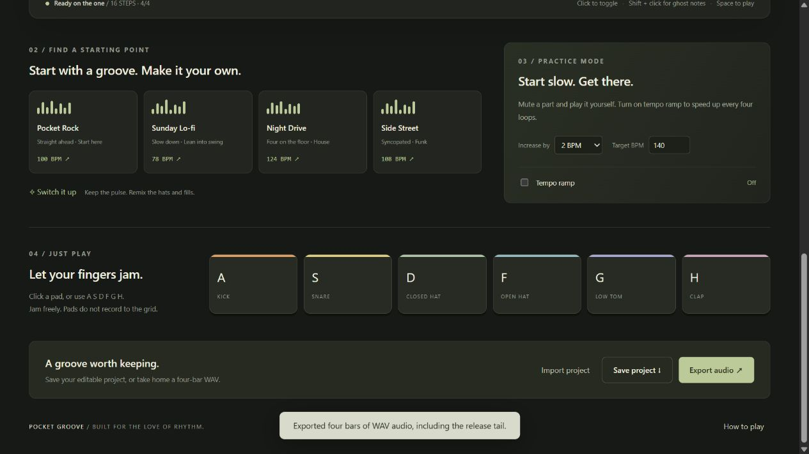

# Pocket Groove · 口袋鼓房

English | [简体中文](README.zh-CN.md)

**[Play live](https://derekllr.github.io/pocket-groove/)** · [Report a bug](https://github.com/Derekllr/pocket-groove/issues)



A tiny, offline-ready drum machine and practice companion. Build a groove on a 6-track / 16-step sequencer, play synthesized drums, and export a four-bar WAV. Switch between English and Chinese without losing your groove. No accounts, samples, or dependencies required.

## Try it

Open **dist/index.html** in a recent Chrome or Edge browser and click 开始播放. The built page contains all CSS and JavaScript and works without a server. Browser storage on local files may vary; export JSON to keep a reliable backup.

## Features

- Six synthesized voices: kick, snare, closed/open hi-hat, low tom, clap; closed hat chokes open hat.
- 16 sixteenth-note steps in 4/4, normal and ghost-note velocities.
- Tempo 40–220 BPM, swing 0–50%, tap tempo, optional metronome.
- Per-track mute, multi-track solo, and gain; master gain and compressor.
- Four editable starting patterns; randomized hi-hat/fill variation; 40-step arrangement undo.
- Keyboard pads A/S/D/F/G/H; Space starts/stops outside input fields.
- Practice ramp: increase tempo every four loops until a chosen target. Mute a part to play it yourself.
- Validated JSON import/export, browser-local autosave, offline rendering to PCM16 mono WAV.
- Responsive layout, accessible control labels, reduced-motion support.
- English / Chinese language switch with persisted preference, including help, notifications and dynamic accessible labels. Custom pattern names remain untouched.

## Develop

Node.js 20+ is enough; there are no third-party packages to install.

```sh
npm test
npm run build
npm start
```

Preview: http://127.0.0.1:4173. Edit `src/`, then rebuild. `dist/index.html` is generated, not the source to edit.

```text
src/model.mjs   Pattern schema, presets, timing, validation, WAV encoder
src/engine.mjs  Web Audio synthesis and mixing
src/app.mjs     Sequencer, scheduling, UI, persistence, practice, exports
src/i18n.mjs    Bilingual copy and dynamic label translation
src/style.css  Responsive visual design
src/index.html Page structure
tests/         Timing, validation, mixing, WAV and synthesis regression checks
build.mjs      Dependency-free single-file bundler
serve.mjs      Minimal local preview server
```

## How the timing works

The UI timer wakes every 20 ms and schedules audio 70 ms ahead using the AudioContext clock. Animation uses requestAnimationFrame and the same audio timestamps; it does not drive sound timing. Swing lengthens the first step and shortens the second step of each pair while preserving the bar duration. This is a browser sequencer, not a hardware-latency measurement tool. It pauses when hidden or when scheduling falls behind rather than playing a burst of missed notes.

WAV export uses a fresh OfflineAudioContext and the same instrument synthesis. It renders four repeats at the captured tempo and mix, plus 550 ms of release tail. Metronome and practice ramp are deliberately excluded from export. Noise voices are randomly synthesized, so exports are not bit-for-bit identical.

## Validation and limits

Automated checks cover preset roundtrips, timing invariants, solo/mute, rejected imports, PCM headers/clipping, and open-hat choke regression. Browser checks covered rendering, step/ghost edits, undo, clear/restore, playback startup, and successful offline audio rendering. Long practice sessions, physical audio latency, and cross-browser audio quality still need human listening and device testing.

This first version is a one-bar pattern repeated during playback, not a full song arranger. It does not import sheet-music PDFs, transcribe songs, record microphone input, or score live drumming. The grid is an editable rhythm representation rather than standard staff notation.

## Make it your project

This initial version was created with AI assistance. To develop it into a personal portfolio project, understand the timing and synthesis code, add your own feature, test it, and document your contribution honestly. Good next steps: a multi-bar arranger; drum-staff view; MIDI export; a practice-session log; velocity-sensitive input. Do not claim user counts, performance improvements, or exclusive authorship without evidence.

To host with GitHub Pages, choose Deploy from a branch, main, / (root). The build also emits `index.html` at the repository root for this purpose. This package contains no GitHub credentials. Sites hosting configuration is separate from the application and is not required for GitHub Pages.

## Contributing

Bug reports, ideas and pull requests are welcome. Include your browser version and reproduction steps. Run `npm test` and `npm run build` before opening a pull request; commit both generated HTML files. Keep personal data out of shared project files.

## License

MIT. All drum sounds are synthesized in code; no external audio samples or fonts are bundled.

